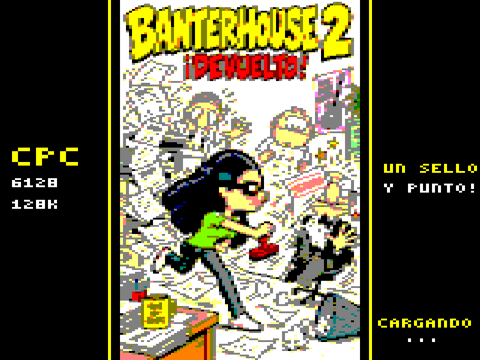

# Banterhouse 2 · ¡Devuelto!

**Un sello, una agencia fuera de control y un Amstrad CPC.**

Pitu vuelve al trabajo. Alberto ha prometido todas las versiones de una campaña para antes de las seis y las fotocopiadoras no dejan de escupir encargos. Esta vez, Pitu ha encontrado una respuesta: **DEVUELTO**.

Banterhouse 2 es un juego arcade en desarrollo para el **Amstrad CPC 6128 clásico de 128 KiB**. Corre, salta entre plataformas y devuelve el papel para apagar las máquinas. La idea es recuperar ese placer de los juegos de los ochenta: pocos controles, acciones rápidas y ganas de volver a intentarlo.

[Descargar el disco](release/Devuelto-CPC6128.dsk) · [Cómo jugar](docs/game/PLAYING.md) · [La historia](docs/game/STORY.md) · [Cómo está hecho](docs/development/GETTING_STARTED.md) · [Toda la documentación](docs/README.md)

*La portada en formato CPC, ampliada a proporción 4:3. Es la imagen de arranque; no una captura de la partida.*

## Nostalgia con trabajo pendiente

La secuela conserva a Pitu, Alberto y el humor de agencia de [Banterhouse](https://github.com/fersantxez/banterhouse), y busca una jugabilidad nueva. El sprite de Pitu marca el estilo: color pop, siluetas claras y personajes de cómic. Prince y otros iconos de los ochenta aparecen como referencias para el mundo que estamos construyendo.

La aventura imaginada va de las copias infinitas a la producción, sale a la calle y termina en una presentación al cliente que nadie debería haber aprobado. [Aquí empieza la historia](docs/game/STORY.md).

## Qué puedes probar

Existe un **prototipo jugable de 24 arenas y cuatro capítulos**, con música AY, efectos, pausa, reintento y pantalla final. El disquete carga los recursos de cada capítulo según hacen falta; no tiene que caber toda la aventura en una sola carga.

Se ha recorrido la campaña técnica en emuladores. La historia completa y el acabado final siguen en desarrollo, y aún no hay validación en un CPC físico. [Estado y límites de la versión](docs/STATUS.md).

La [guía del jugador](docs/game/PLAYING.md) explica el disco y los controles. El [disco listo para jugar](release/Devuelto-CPC6128.dsk) está incluido. También puedes construirlo desde las fuentes siguiendo [la primera compilación](docs/development/GETTING_STARTED.md).

## ¿Cómo se hace un juego así?

Con C, ensamblador Z80, CPCTelera y herramientas que convierten dibujos, niveles y música en datos que entiende el CPC. La documentación empieza por construir el disco y después sigue una partida por dentro: entrada, física, dibujo, sonido y cargas.

**[Entra por aquí para aprender cómo funciona](docs/README.md).** No hace falta leer los antiguos planes de ingeniería para empezar.

[Colaborar](CONTRIBUTING.md) · [Créditos y procedencia](THIRD_PARTY.md) · [Nota de distribución](COPYING.md)
