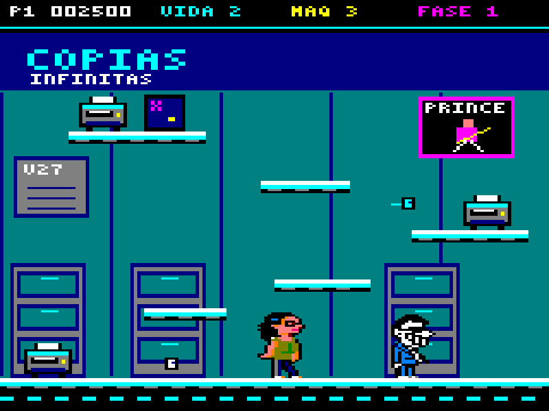
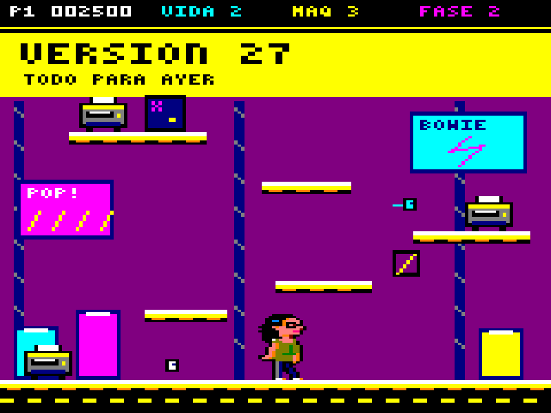
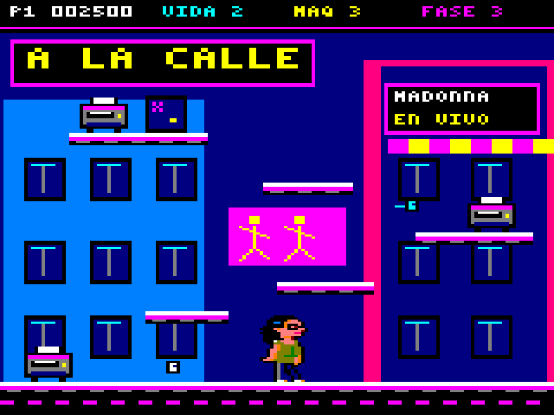
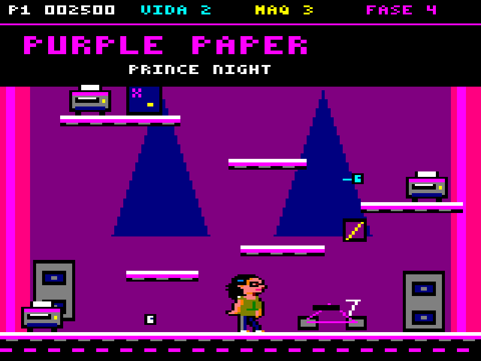

# Estudios gráficos CPC

11 de octubre de 2026. Estas cuatro imágenes sustituyeron a las primeras maquetas, que tenían demasiado detalle para el CPC. Se dibujaron con índices de tinta, se codificaron a memoria de vídeo y se decodificaron de nuevo para comprobar el resultado. Las maquetas descartadas se guardan fuera del repositorio.

**Son pantallas estáticas construidas en el Mac, no capturas de un emulador ni de un juego funcionando.** La verificación cubre píxeles, paleta, direccionamiento y bytes de recursos; todavía no cubre movimiento, colisiones, Z80, audio o cargas físicas.

## Pantallas

### 1. Copias infinitas



Archivadores repetidos, fondo cian oscuro, copiadoras pequeñas y un cartel de Prince de 28×30 píxeles. Pitu y Alberto son los sprites originales, conservando sus píxeles y sus colores. Alberto aparece aquí como referencia de reparto y escala.

### 2. Producción urgente



Amarillo y magenta, bobinas estáticas y el rótulo «VERSIÓN 27». El guiño a Bowie cabe en un cartel y un rayo. El reflector es un panel diagonal pequeño; se representa su presencia, todavía no su comportamiento. Art y Carlitos necesitan sprites nativos antes de incorporarse: la hoja conceptual anterior no cuenta como un recurso terminado.

### 3. La campaña sale a la calle



Dos fachadas hechas con bloques y ventanas repetidas, toldo a franjas, cartel de Madonna y mural original de figuras esquemáticas. La perspectiva compleja de la maqueta anterior se sustituye por una composición frontal. Las superficies caminables comparten el borde blanco de las demás fases.

### 4. Purple Paper



Telón magenta, focos representados por triángulos de color plano, altavoces y una moto reducida a un icono estático. El cartel hace referencia a Prince. Todo está dibujado con colores planos, sin transparencias, iluminación calculada ni partículas.

## Formato y restricciones

- **Mode 0 estándar: 160×200 píxeles lógicos.** Las vistas ampliadas miden 800×600: cada píxel lógico ocupa exactamente 5×3 píxeles de la vista. Esto aproxima una presentación 4:3 sin suavizado. No pretende simular un monitor CRT.
- **16 posiciones de paleta** con colores del CPC clásico. Uso visible: 15 colores en oficina, taller y plató; 14 en calle. No hay Plus, rasters ni cambios de modo o paleta durante la pantalla. Los RGB del PNG son una aproximación digital de los niveles analógicos.
- **Pitu y Alberto: 16×32 píxeles lógicos.** Cada pose enmascarada fuente ocupa 512 bytes. Se conserva la paleta de todos los índices opacos usados por ambos. Sólo se reasignan índices libres para el decorado.
- **Tres máquinas estáticas, dos papeles pequeños y Pitu** por escena. La oficina añade a Alberto. Para saber si esa cantidad puede moverse a la velocidad prevista hay que probarla en el juego.
- Fondo y HUD estáticos en estas imágenes. Dibujar una fotografía fija no exige moverla cada fotograma; el coste de restaurar el fondo y redibujar actores se tendrá que medir en el prototipo.
- Las cuatro escenas comparten deliberadamente una geometría. Son cuatro tratamientos gráficos de una arena de prueba, no cuatro niveles ya diseñados y probados. F05 fijó la primera plataforma en X=42, Y=150, ancho 24: queda 34 píxeles sobre el suelo y su borde deja libre el sprite 16×32 apoyado bajo la siguiente. Los saltos simulados alcanzan las seis superficies. Esto valida la geometría del prototipo, no diversión ni niveles de campaña finales.

La resolución y la codificación siguen la [documentación de Mode 0 de CPCTelera](https://lronaldo.github.io/cpctelera/files/sprites/cpct_px2byteM0-asm.html); las tintas siguen su [tabla firmware/hardware del CPC clásico](https://lronaldo.github.io/cpctelera/files/video/colours-h.html). Fuentes primarias consultadas el 11 de octubre de 2026. El [direccionamiento de pantalla](https://lronaldo.github.io/cpctelera/files/video/cpct_getScreenPtr-asm.html) usa 80 bytes visibles por línea, intercaladas en ocho grupos.

## Recursos medidos

| Escena | Tiles únicos de 8×8 | Bytes de tiles | Mapa de 20×25 | Fondo por tiles + mapa |
|---|---:|---:|---:|---:|
| Copias | 144 | 4.608 | 500 | **5.108 B** |
| Producción | 155 | 4.960 | 500 | **5.460 B** |
| Calle | 199 | 6.368 | 500 | **6.868 B** |
| Purple Paper | 145 | 4.640 | 500 | **5.140 B** |

Cada tile contiene 32 bytes M0. Estos recuentos incluyen HUD, rótulos, máquinas y decoración estática; excluyen personajes y los dos papeles. Se extrajeron tiles únicos después de dibujar: es una representación exacta y reproducible, aún no una biblioteca artística optimizada entre habitaciones. Cada mapa usa índices de un byte. No se suman estos fondos como si los cuatro tuvieran que estar residentes a la vez.

Cada `.scr` ocupa **16.384 B**: 16.000 B visibles y 384 B de huecos de la distribución estándar. El bitmap completo y la representación de tiles son formatos alternativos del mismo fondo; un motor que conserve ambos debe presupuestar ambos. Ni los tamaños del fondo ni la compresión incluyen código, música, colisiones, animaciones o una campaña completa.

Pitu está en una coordenada horizontal impar en esta composición. Un renderer por bytes tendrá que desplazar su sprite o disponer de la variante desplazada: una pose enmascarada de 9 bytes por línea ×32 líneas cuesta **576 B**, frente a los 512 B alineados. El dibujo estático no demuestra que esa ruta de blitting exista o sea rápida.

El [manifiesto](manifest.json) registra hashes, posiciones, paletas, bytes y, al generar con `--compress`, tamaños ZX0 del fondo completo y verificación de descompresión host. Esa compresión sirve como alternativa de almacenamiento; no mide tiempos de disco ni del descompresor Z80.

Medición ejecutada con ZX0 `ecde3a2ae05061fe06469ed46df81a33b7de7d86`, formato forward por defecto: los fondos de Copias, Producción, Calle y Purple Paper pasan de 16.384 B cada uno a **1.081, 1.240, 1.185 y 1.143 B**, respectivamente. Las cuatro descompresiones host recuperan exactamente el original. Son bitmaps muy repetitivos; no extrapolar esta relación a música, código o al arte futuro. Al descomprimir siguen necesitando 16.384 B; esta cifra no se suma al paquete de tiles como si fuese otro decorado.

## Reproducir y usar los archivos

Desde la raíz del proyecto:

```sh
python3 tools/build_cpc_screen_studies.py
# Opcional, con los binarios locales descritos en research/README.md:
python3 tools/build_cpc_screen_studies.py --compress
```

Python estándar, sin Pillow, generador de imágenes ni herramientas globales nuevas. El script lee `graphics.c` y comprueba la paleta de `main.c` en `../banterhouse`; no escribe allí. `--original` permite indicar otra copia de esas fuentes. Los hashes del manifiesto identifican exactamente las entradas.

- `*.scr`: 16 KiB crudos en distribución VRAM CPC estándar, sin cabecera AMSDOS. Para un visor propio, establecer Mode 0 y origen de pantalla estándar, copiar en `&C000` y aplicar su paleta. **No se presentan como ficheros preparados para `LOAD` de BASIC ni como un disquete arrancable.**
- `*.fwpal`: 16 bytes, números de tinta firmware 0–26.
- `*.hwpal`: 16 bytes, valores Gate Array `0x40 | código_hardware`; el código consumidor debe seleccionar cada pen antes de escribir su valor.
- `*.background.scr`: fondo sin Pitu, Alberto o proyectiles.
- `*.tiles.bin` / `*.map.bin`: tiles M0 por filas; mapa por filas, índices desde cero.
- `*.native.png`: imagen indexada 160×200, sin corrección de aspecto.
- `*.png`: vista ampliada 800×600 obtenida al decodificar el `.scr`.
- `g_*.masked.bin`: copias exactas de las poses fuente utilizadas o de referencia.

Comprobaciones ejecutadas: ida/vuelta para los 256 valores posibles de un byte M0; 16.000 direcciones visibles únicas y vectores de borde; reconstrucción de cada imagen desde el `.scr`; reconstrucción exacta de cada fondo desde tiles y mapa; máscaras válidas y conservación de las tintas de los personajes. Se revisaron visualmente las cuatro vistas ampliadas.

## Pruebas pendientes

Los fondos se pueden seguir dibujando dentro de esta rejilla y paleta. Para decidir cuántos objetos se pueden animar hay que medir el dibujo y la respuesta a los controles en el CPC.

El siguiente paso jugable sigue siendo movimiento y devolución con sonidos, sobre la oficina. Hay que comprobar legibilidad de pelo negro sobre cada fondo, proyectiles en movimiento, saltos, coste de restauración, sprites desplazados, peor cuadro e input a imagen. Después se refinan los otros escenarios. Las cargas entre capítulos amplían la variedad disponible en disco; no aumentan la resolución, las tintas simultáneas ni el tiempo de CPU por fotograma.
