# Disquete, memoria y contenido de ¡Devuelto!

> **Diseño e investigación históricos.** Este documento conserva propuestas y decisiones de su fecha; no describe por sí solo la build actual. Consulta [Estado](STATUS.md) y [la guía de lectura](README.md).

Plan propuesto · 11 de octubre de 2026. Se coordina con la [historia de 24 pantallas](STORY_STRUCTURE.md). **Las reservas son límites de diseño; no ocupación de un ejecutable ni tiempos medidos.** La comprobación host sólo valida aritmética. No se ha creado el loader ni el DSK de la secuela.

## Decisión de estructura

Objetivo de edición: **un disquete de 3 pulgadas, dos caras usadas por separado**, con capítulos 1–2 en A y 3–4 en B. Una vuelta manual a mitad de una partida completa. Ambas caras contienen un arranque y el conjunto común para continuar desde un código sin volver a A. Si el arte definitivo rebasa las cuotas, ampliar a dos disquetes antes de perjudicar control o identidad visual; el objetivo de un disco aún no está demostrado.

La memoria conserva lo necesario para la acción actual. El disco guarda lo que vendrá después. Descargar significa invalidar y reutilizar una región de RAM; no hay que escribir los gráficos viejos de vuelta al disquete. Sólo se conserva un pequeño estado de progreso.

Cinco arenas normales por capítulo comparten un paquete activo; el sexto escenario puede cargar un paquete de encuentro. Una pantalla normal nueva se reconstruye desde mapas y piezas residentes. Reintentar nunca provoca una lectura. El disco se usa con la simulación detenida, en entrada de capítulo, antes del encuentro especial y durante viñetas/final.

## Qué ve el jugador

```mermaid
flowchart LR
    A[Arranque cara A] --> I[Introducción breve]
    I --> C1[Carga capítulo 1]
    C1 --> N1[5 arenas y reintentos en RAM]
    N1 --> J1[Carga encuentro 1]
    J1 --> C2[Viñeta y capítulo 2]
    C2 --> N2[5 arenas y encuentro 2]
    N2 --> V[Viñeta: salir a la calle]
    V --> B[Girar a cara B]
    B --> C3[Capítulo 3 y encuentro]
    C3 --> C4[Capítulo 4 y encuentro final]
    C4 --> F[Carga del desenlace]
```

Una viñeta ya visible puede permanecer mientras se sustituyen otros bancos. Eso no implica que esté animándose ni que su música pueda continuar durante toda transferencia. Saltarse la viñeta elimina la espera editorial, no los bytes que falten por leer; mostrar un indicador sobrio y permitir empezar en cuanto los datos estén listos.

| Momento | Operación | Garantía que queremos validar |
|---|---|---|
| Salto, devolución, impacto | Datos expandidos residentes | Cero llamadas a disco ni descompresión larga en la ruta crítica |
| Muerte/reintento | Restablecer estado inicial y recomponer | Cero lecturas; latencia de reinicio por medir |
| Arena 1→2→3→4→5 | Elegir mapa, componer fondo, reiniciar actores | Cero lecturas si el paquete normal cumple su presupuesto |
| Arena 5→encuentro | Sustituir recursos de capítulo por los específicos del encuentro | Una transición segura; todos los reintentos y fases después residen |
| Fin de encuentro→nuevo capítulo | Mostrar viñeta y cambiar paquete | Liberación explícita; no conservar todos los capítulos |
| Capítulo 2→3 | Validar cara B, cargar paquete | Un cambio manual en el recorrido base |
| Final | Sustituir datos de combate por viñetas/créditos | Mayor imagen sin pagar simultáneamente el combate completo |

## Conjunto de memoria propuesto

Partir de la candidata A de [ARCHITECTURES.md](ARCHITECTURES.md), **no de una arquitectura ya aprobada**. Es favorable para esta primera cámara completa porque deja código y buffers fijos; debe superar pruebas de restauración, tearing y respuesta. El doble búfer sigue siendo alternativa si sus resultados lo justifican.

| Banco físico | Uso durante gameplay | Reserva |
|---|---|---:|
| RAM0 | Núcleo, ISR, entrada, bancos, loader/decoder, audio, estado y pila | 16 KiB |
| RAM1 | Fondo limpio de la pantalla actual | 16 KiB |
| RAM2 | Lógica y overlay 8; scratch 4; save-under 2; trabajo/guardas 1; margen 1 | 16 KiB |
| RAM3 | Pantalla visible | 16 KiB |
| RAM4 | Recursos de Pitu 14; margen 2 | 16 KiB |
| RAM5 | Tiles/piezas 12; colisión e índice activos 2; margen 2 | 16 KiB |
| RAM6 | Personajes activos 12; efectos 2; margen 2 | 16 KiB |
| RAM7 | Mapas del capítulo y caché de bloques 14; índices/margen 2 | 16 KiB |
| **Total físico** | **32 núcleo/trabajo + 32 fondo/vídeo + 64 recursos** | **128 KiB** |

RAM0 mantiene las reservas detalladas de A: vectores 256 B; código 8.960 B; canción/SFX 3.072 B; estado 2.048 B; buffers de sector 1.024 B; guardas 256 B; pila 768 B. Es una cuota exigente para todo el núcleo. Si el enlace no cabe, redistribuir antes de producir contenido, sin invadir pila o staging.

En los 8 KiB de lógica de RAM2 se propone probar 4 KiB fijos y 4 KiB de código sustituible. Esta subdivisión es una evolución de A; el documento anterior no acredita que quepa. La lógica común que necesiten menú, encuentro y recuperación vive en la parte fija o RAM0. Los mapas de las cinco arenas se cuentan dentro de RAM7, no como memoria gratuita añadida al índice.

RAM0, RAM2 y RAM3 quedan fijas bajo el contrato de paginación elegido. RAM1 y RAM4–7 comparten la ventana CPU 4000–7FFF; no están accesibles a la vez. El vídeo usa RAM física principal. Restaurar fondo y dibujar actores requiere fases separadas con cambio de banco. [Tabla de paginación de CPCTelera](https://lronaldo.github.io/cpctelera/files/memutils/cpct_pageMemory-asm.html).

Para componer el fondo desde tiles de RAM5 hacia RAM1 tampoco se dispone de ambas a la vez: copiar una tanda de piezas o una banda al scratch fijo, cambiar banco y escribirla en el fondo. Esta composición ocurre al entrar, con la acción detenida. Su tiempo y el staging se cuentan dentro de las mismas reservas.

## Carga segura y pico de memoria

El packer divide recursos en **bloques independientes**, con entrada de hasta 4 KiB y salida de hasta 4 KiB en esta primera implementación. Un bloque que no comprima mejor se guarda raw. Esta granularidad simplifica staging y recuperación a cambio de perder algo de compresión entre bloques; medir contra bloques mayores antes de cambiarla.

Ruta desde disco: FDC → buffer fijo de sector → scratch fijo de 4 KiB en RAM2 → decoder fijo → banco destino. Ruta desde caché: mapear RAM7 → copiar bloque a scratch fijo → mapear destino → expandir. No intentar leer RAM7 y escribir RAM4 como si ambas fueran simultáneamente visibles en 4000.

Pico explícito: fuente comprimida ≤4 KiB dentro del scratch, destino ≤4 KiB dentro del banco asignado, pila y estado del decoder en sus reservas. El recurso antiguo de destino ya se ha invalidado: no se mantienen dos capítulos expandidos. Durante gameplay el scratch puede ayudar al compositor; durante carga ese trabajo está suspendido. No sumar ambas ocupaciones ni fingir que el scratch está disponible mientras lo usa el renderer.

Cada bloque incluye ID, versión, volumen, tamaños, formato, destino permitido y checksum. El loader verifica rangos y límites antes de expandir. El decoder no debe poder sobrepasar su destino: validación previa de la entrada o decoder con comprobaciones, más guardas en pruebas. El checksum posterior no evita por sí solo una escritura fuera de rango.

Secuencia de transición:

1. Guardar checkpoint mínimo en RAM fija: capítulo, arena/fase, modo, puntuación válida y ajustes.
2. Detener actores/audio según política y dibujar la transición con recursos ya residentes.
3. Volver al gestor residente, invalidar handles salientes y aumentar generación; no retornar a código descargado.
4. Validar cara/versión y cargar los bloques, con reintentos acotados.
5. Validar conjunto completo, reconstruir fondo/colisión y copiar los datos calientes de música.
6. Activar el nuevo estado sólo al terminar. Ante error, permanecer en pantalla residente de recuperación y reintentar el paquete; nunca continuar con media escena cargada.

La pantalla de error, el texto de cambio de cara y su fuente mínima viven en el núcleo, no en el paquete que puede fallar. Volver al menú de lujo puede requerir cargarlo; el menú mínimo de recuperación siempre debe funcionar.

## Ahorros que incorporaría al diseño

| Técnica | Qué permite ahorrar | Condición o coste |
|---|---|---|
| Paquetes por capítulo/encuentro | RAM de mundos y reparto que no están en escena | Carga en transición; paquetes con dependencias completas |
| Arenas de recursos con vida conocida | Metadatos de asignación y fragmentación | Reiniciar la región de una vez; nada de punteros conservados a datos viejos |
| Tiles y metatiles + piezas únicas | Disco y RAM de fondos repetidos | Conservar carteles y máquinas singulares para dar identidad |
| Mapas compactos y recetas de composición | Evitar guardar seis imágenes completas por capítulo | Reconstrucción al entrar; medir duración |
| Estado separado de imagen | Reintento con pocos bytes y fondo reconstruible | Guardar máquinas apagadas como bits/IDs, no capturas de pantalla |
| Recorte de cajas y deduplicación exacta de frames | Píxeles transparentes y poses idénticas | Anclajes estables, colisión independiente del recorte |
| Espejos y desplazamientos preparados al cargar | Copias en disco | Las variantes expandidas siguen ocupando RAM; generar fuera del cuadro crítico |
| Variantes y código compilado sólo para poses frecuentes | CPU donde más aporta, evitando multiplicar todo | Comparar con sprite genérico; código compilado puede ocupar más |
| Subanimación de máquinas grandes | RAM de frames completos | Carcasa como fondo, sólo boca/luces/palancas móviles; fondo limpio se actualiza al apagar |
| Retrato base + ojos/boca/mano | Frames de viñetas | Composición explícita y fidelidad al personaje |
| Reutilizar scratch y código por fases | RAM de tareas mutuamente excluyentes | Diagrama de vida y entrada/salida del overlay auditados |
| Compresión por bloques de recursos fríos | Espacio en disco/caché | CPU al expandir; no reduce automáticamente RAM activa |
| Música por patrones e instrumentos compartidos | Disco y datos musicales | Exportar sólo funciones usadas; coste de player + SFX incluido |
| Tablas, máscaras, recortes y mapas calculados en el Mac | Código y trabajo repetido en CPC | Las tablas tienen coste de RAM; algunas cambian CPU por espacio |
| Texto corto, fuente común y diccionario sólo si compensa | Disco/RAM de narrativa | Contar también índices y descompresor de texto |
| Paquetes contiguos y ordenados por consumo | Búsquedas de pista y sobrecoste de archivos pequeños | La colocación física se obtiene del DSK final, no se adivina |
| Duplicar común en ambas caras | Evita cambios de cara al continuar | Consume disco deliberadamente para mejorar la experiencia |

Los colores pop no implican almacenar una paleta distinta por objeto: unificar tintas por escena, preservar primero Pitu y definir contraste del resto. Las hojas generadas de personajes son conceptos; hay que convertirlas a píxeles, máscaras y paleta de producción antes de presupuestar sus bytes.

**Ejemplo de fondos, aritmética ilustrativa:** una pantalla almacenada en una página ocupa una reserva de 16 KiB; cinco páginas ocuparían 80 KiB. Un vocabulario de 256 tiles de 8×8 Mode 0 requiere 8 KiB, y cinco mapas de 20×25 índices de un byte suman 2.500 B: 10.692 B antes de colisiones, piezas únicas, máscaras, compresión e índices. No es el tamaño medido de nuestro arte. El fondo reconstruido y la pantalla visible siguen ocupando sus dos reservas de 16 KiB.

**Ejemplo de sprites:** ocho poses de 16×32, dos direcciones y ambas alineaciones con máscara requieren 17.408 B y desbordan un banco. Seis poses bajo el mismo cálculo requieren 13.056 B y caben en una reserva de 14 KiB, antes de otros metadatos o código. Esto sirve para detectar el problema, no para imponer seis poses a Pitu. Probar deduplicación, recorte, poses compartidas y variantes selectivas antes de quitar animación o empeorar el movimiento.

## Técnicas que ensayaría, sin sumar ventajas incompatibles

- **Cabeza/cuerpo por piezas:** atractiva para este reparto, pero añade llamadas de dibujo, uniones y orden. Mantener frames completos si quedan mejor o son más rápidos. No desfigurar a Pitu para facilitar el ensamblaje.
- **Deltas entre poses o viñetas:** pueden reducir disco; reconstruir fuera del cuadro crítico y contar el frame base. Deltas largas encadenadas empeoran acceso y recuperación.
- **Máscaras generadas:** reducir datos almacenados sólo si color/transparencia están definidos. Negro opaco y transparente son estados distintos.
- **Reconstruir regiones desde tiles en vez de fondo limpio:** podría liberar RAM1, pero consume CPU. No declarar esos 16 KiB libres manteniendo simultáneamente el método de restauración anterior.
- **Doble búfer:** mejora posible de presentación a cambio de memoria fija; no es un ahorro de RAM ni una garantía de fluidez.
- **Rasters, split, overscan:** opciones de presentación, no compresión. Paletas por bandas pueden alterar sprites que las crucen y overscan aumenta datos. Ensayo independiente de CRTC.
- **Audio durante carga:** estudiar servicio entre transferencias del FDC. Empezar con pausa/fade coherente; no ejecutar ISR arbitraria dentro del servicio de bytes. El fabricante documenta fases y errores de overrun. [NEC µPD765A](https://cpctech.cpcwiki.de/docs/upd765a/necfdc.htm).
- **Descompresión con solape o lectura incremental:** sólo con un decoder/formato que lo permita y pruebas de peor caso. La primera ruta usa bloques independientes y staging separado.
- **Más pistas, formatos de mayor capacidad, trucos en cabeceras o huecos de vídeo:** reservas potenciales pequeñas o dependientes del formato; no sostienen el alcance base. Compatibilidad y mantenimiento pesan más que agotar cada byte teórico.

Aplicar todos los trucos simultáneamente no maximiza el resultado: unos ahorran RAM gastando CPU, otros ahorran tiempo gastando disco. Se conservarán los que mejoren la escena real y su fiabilidad.

## Compresión y empaquetado

Comparar [ZX0](https://github.com/einar-saukas/ZX0) y [LZSA](https://github.com/emmanuel-marty/lzsa) con el nuevo corpus. Elegir inicialmente un solo decoder más copia raw. El criterio incluye tamaño del decoder, pila, tiempo de expansión y tamaño final del paquete; no sólo ratio.

La [investigación host previa](../research/README.md) midió una pantalla del original de 16.384 B a 6.292 B con ZX0 y 6.516 B con LZSA2; comprobó round-trip host. Es evidencia sobre ese archivo, no promesa de comprimir a la misma proporción los personajes o escenarios nuevos. No se han medido los decoders Z80 ni FDC.

Contenedor por volumen, con directorio interno: `COMMON`, `INTRO`, `CH1_NORMAL`, `CH1_ENCOUNTER`, `CH1_OUTRO`, etc. Cada recurso tiene hash de contenido en el build y checksum en disco. Deduplicar dentro del volumen y hacer explícita la duplicación entre caras. Bloques no cruzan el límite de un banco destino. El packer emite dependencias, sectores reales, tamaños comprimidos/expandidos y pico por fase.

Arranque con AMSDOS; después loader FDC propio o adaptado del laboratorio, auditado. Conservar el código que resulte útil de CPCTelera no impide usar bancos, compresión u overlays. No adjudicar un ahorro a cambiar de librería sin medir el mismo trabajo.

## Cuota inicial de las dos caras

Formato de planificación: DATA, 40 pistas × 9 sectores × 512 B = **184.320 B por cara**; reservar 2 KiB al directorio deja **178 KiB** antes de cabeceras y redondeos, que aquí tienen cuota adicional. Es un presupuesto lógico del medio; el archivo DSK del emulador añade estructura y no representa ese espacio útil. Véanse las [facilidades AMSDOS del manual de firmware](https://cpctech.cpcwiki.de/docs/manual/s968se19.pdf) y el [plan técnico anterior](TECHNICAL_RESEARCH.md#disco-compresión-y-recursos).

| Contenido, cuotas en KiB ya empaquetados | Cara A | Cara B |
|---|---:|---:|
| Arranque, núcleo, Pitu y recursos comunes duplicados | 40 | 40 |
| Capítulo 1, normales + encuentro + remate | 44 | — |
| Capítulo 2, normales + encuentro + remate | 48 | — |
| Capítulo 3, normales + encuentro + remate | — | 48 |
| Capítulo 4, normales + encuentro | — | 52 |
| Introducción | 8 | — |
| Intermedio de cambio de cara | 6 | — |
| Desenlace y créditos | — | 10 |
| Índices internos, versiones y checksums | 4 | 4 |
| Cabeceras de archivo, redondeo y colocación | 4 | 4 |
| Reserva sin contenido asignado | 24 | 20 |
| **Total tras directorio** | **178** | **178** |

La cuota de un capítulo contiene varios paquetes que **no coexisten expandidos**. Una cuota de 52 KiB en disco no afirma que se pueda cargar íntegra en una sola región de RAM. Las viñetas y encuentros usan memoria sustituida; el conjunto normal debe cumplir aparte RAM5/6/7, música y overlay. Si sólo caben tres arenas en ese conjunto, añadir una transición entre bloques de arenas y medir su efecto antes de producir las 24.

La distribución cabe por aritmética con reservas de 24/20 KiB, no por empaquetado real: aún no existen esos recursos. El archivo [campaign-storage-budget.json](../research/campaign-storage-budget.json) y su comprobador conservan esa distinción.

## Plan de ejecución y criterios de cierre

1. M0/M1: movimiento, sonido y devolución. Mantener el canon de Pitu y ajustar control jugando.
2. M2: tres máquinas, un perseguidor, rutas y rebote. Primera escena artística con recursos reales y mapa de linker.
3. Crear un paquete normal de dos arenas y otro de encuentro, más viñeta. Alternarlos desde DSK y reiniciar sin lecturas; confirmar con contador FDC, guardas, generaciones y checksums.
4. Comparar renderers equivalentes y ZX0/LZSA con ese corpus. Medir peor cuadro, latencias, RAM activa, pico de carga, pila, disco frío/caliente, expansión y primera imagen jugable.
5. Probar carga fallida, cara equivocada, paquete truncado y versión incorrecta. Checkpoint permanece recuperable; no hay retorno a overlay sustituido.
6. Producir un capítulo completo, medir variedad y ritmo, y congelar cuotas sólo con esos datos. Después escalar campaña y empaquetar ambas caras.
7. Validar en emuladores y CPC 6128 clásico físico, incluida disquetera. Plus o medios alternativos son cobertura adicional.

Estado de esta revisión: historia y estructura documentadas, cuotas y ejemplos aritméticos comprobados en host; ejecución CPC, FPS, tiempos de carga, coexistencia final de arte/audio y diversión siguen pendientes. No se ha implementado streaming durante la acción.
