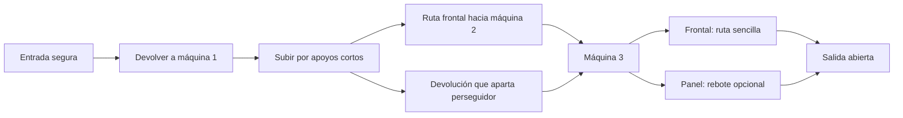

# Banterhouse 2 — ¡Devuelto!

> **Diseño e investigación históricos.** Este documento conserva propuestas y decisiones de su fecha; no describe por sí solo la build actual. Consulta [Estado](STATUS.md) y [la guía de lectura](README.md).

Diseño propuesto v0.2 · actualizado el 11 de octubre de 2026 · CPC 6128 clásico de 128 KiB.

**Un plataformas arcade de saltos, esquivas y devoluciones: Pitu convierte los disparates de la agencia en proyectiles contra sus propias máquinas.** Cada pantalla debe dejarte pensando que podrías haberla resuelto de una forma más rápida, más elegante o más absurda.

Este documento escoge una dirección concreta para desarrollar. Es una propuesta de diseño, no un juego implementado ni una declaración de diversión validada. El título es de trabajo. Los personajes existentes conservan identidad; los nuevos y sus papeles son propuestas. Los valores numéricos son puntos de partida para probar.

Desarrollo de campaña: [historia y estructura de las 24 pantallas](STORY_STRUCTURE.md). Producción en disquete: [paquetes, memoria, cargas y cuotas por cara](DISK_CONTENT_PLAN.md).

## 1. La experiencia que buscamos

Entras, lees el peligro, saltas una ráfaga, devuelves un expediente al vuelo, lo haces rebotar en un cartel y atascas una fotocopiadora. Su motor se para con un ruido ridículo. Aterrizas ya mirando al siguiente problema.

La diversión debe empezar en esa secuencia de pocos segundos. La campaña y la puntuación añaden motivos para dominarla. El juego no depende de diálogos para explicar por qué merece la pena moverse.

Tres compromisos de diseño:

1. **Pitu responde primero.** Caminar, cambiar de dirección y saltar no esperan a una animación vistosa. Se puede devolver un proyectil sin detenerse ni perder control aéreo.
2. **Una acción produce muchas jugadas.** Devolver sirve para defenderse, atacar máquinas, apartar enemigos y aprovechar rebotes. No hay inventario de herramientas ni combinaciones de botones diferentes para cada objeto.
3. **El caos se entiende.** Antes de disparar, una máquina avisa. Cada enemigo tiene una conducta reconocible. Los rebotes tienen trayectorias claras. El jugador puede explicar su error.

El despliegue artístico debe estar en la acción: personajes expresivos, máquinas que reaccionan, espacios con personalidad y sonido que hace palpable cada acierto. No se reduce la ambición a una portada elaborada.

## 2. Referencias CPC y decisión propia

La selección procede de instrucciones archivadas y testimonios de autores; no se han jugado ni cronometrado esas versiones durante esta sesión. Las enseñanzas de diseño son interpretaciones nuestras, no afirmaciones de sus autores sobre Banterhouse 2. Registro detallado: [referencias](GAME_REFERENCES.md).

| Referencia | Qué tomamos como inspiración | Aplicación aquí |
|---|---|---|
| Chuckie Egg, referencia expresada por el usuario | Placer de moverse, recoger y recibir respuesta inmediata | La prueba de movimiento y sonidos precede al contenido y los efectos |
| Bubble Bobble, instrucciones de Firebird | Una acción característica transforma la situación y produce recompensa | Las amenazas se convierten en oportunidades de devolución; la pantalla se lee de un vistazo |
| Rainbow Islands, instrucciones de Ocean | Un mismo recurso sirve para varias funciones | El gesto de devolver combina defensa, ataque y uso del escenario |
| Bomb Jack, instrucciones de Elite | Movimiento vertical y objetivos repartidos por una pantalla | Elegir orden y trayectorias importa; no imponer un pasillo de ejecución única |
| Rick Dangerous, explicación de Simon Phipps | Tema y situaciones físicas construyen una fantasía reconocible | Sátira mediante máquinas y accidentes; nuestros peligros serán anunciados y los reintentos breves |

No se importan cifras de FPS, físicas de otra conversión ni motores supuestos. La combinación concreta —devolver amenazas para apagar un sistema de máquinas— es la hipótesis propia que debemos probar.

## 3. Premisa y tono

El Presidente inaugura **EL PLAN PERFECTO**, un sistema que promete cerrar todas las campañas antes de las seis. Conecta fotocopiadoras, mensajería, producción y publicidad exterior. El sistema empieza a fabricar trabajo más deprisa de lo que nadie puede hacerlo.

Pitu decide devolverlo al remitente. El objetivo es apagar la cadena antes de que una presentación automática convierta toda la ciudad en la campaña más desastrosa de la historia de la agencia.

Pitu conserva su actitud tranquila, irónica y segura. El contraste cómico es una protagonista que resuelve con un gesto seco mientras el entorno entra en pánico. Su velocidad y precisión no requieren convertirla visualmente en una superheroína. No habrá largas conversaciones interrumpiendo una pantalla; las intervenciones caben en transiciones breves que se pueden saltar.

## 4. Reglas centrales

Cada escenario contiene de una a tres **máquinas de encargos**, conectadas visualmente a una salida. Emiten proyectiles de papel con dirección fija y aviso previo. Pitu debe devolver al menos un proyectil contra la boca de cada máquina activa; al desactivarlas se abre la salida. Las máquinas normales no tienen barra de vida ni ventanas de vulnerabilidad: un impacto válido basta.

El orden es libre salvo en las primeras pantallas de enseñanza. Se puede usar el proyectil de una máquina para apagar otra. El jugador elige la ruta segura o una devolución que alcance varios objetivos por el camino.

### El gesto «¡Devuelto!»

Al pulsar acción, Pitu presenta el sello hacia el lado que mira. El gesto actúa en una pequeña zona delante de ella, incluso durante el salto. Un proyectil hostil dentro de esa zona cambia de estado y sale horizontalmente en la dirección de Pitu. El sello produce sonido e imagen en ese instante; la pose posterior no bloquea movimiento.

Un proyectil devuelto:

- muestra un trazo blanco y un pequeño sello, además de cambiar de tinta: su estado no depende sólo del color;
- es inocuo para Pitu;
- aparta de la escena a los enemigos ordinarios que encuentre y continúa;
- desactiva una máquina al entrar en su boca y se consume;
- se consume al tocar pared normal o abandonar la zona jugable;
- puede reflejarse **una vez** en un panel marcado; un segundo panel lo consume. Los paneles iniciales tienen diagonal fija de 45°: desvían 90° una trayectoria horizontal o vertical. Una flecha muestra la salida; no hay ángulos analógicos ocultos.

Los enemigos apartados reaparecen por una entrada señalada mientras queden máquinas activas. No se exige eliminarlos para terminar. El sello por sí solo no daña enemigos ni máquinas: una pulsación al aire produce un pequeño «toc» y sirve para aprender su alcance. No hay munición, carga mantenida ni inventario.

La primera devolución no exige acertar un frame perfecto: comenzamos con una ventana generosa. La destreza debe estar en colocarse y elegir el momento, no en descubrir un truco de precisión oculto. No hay premio adicional por «parry perfecto» en la versión inicial.

### Evitar que el juego se convierta en esperar

Cada máquina puede volver a emitir mientras su proyectil anterior exista, sujeto al límite global. Las oportunidades se alternan entre alturas y posiciones; los lugares seguros permiten aprender, pero no resuelven todas las máquinas desde un punto. Los proyectiles fallidos desaparecen al salir y las máquinas no agotarán su suministro. Siempre debe quedar una fuente capaz de alcanzar el último objetivo.

Los enemigos y la geometría proponen moverse, sin invalidar arbitrariamente una buena posición. El bonus por tiempo anima al experto; el principiante dispone de tiempo para observar. Si el jugador pasa más tiempo aguardando un disparo que ejecutando jugadas, hay que rediseñar frecuencias y rutas: es un riesgo central del concepto.

## 5. Control y movimiento

| Entrada | Acción |
|---|---|
| Izquierda / derecha | Moverse y orientar el sello |
| Arriba, nuevo pulso | Saltar; mantener inicialmente permite un salto algo más alto |
| Botón de acción | Devolver; un gesto por pulsación |
| Abajo, nuevo pulso en plataforma atravesable | Bajar a la siguiente altura; no actúa en suelo sólido |
| Pausa / reinicio | Teclas separadas, disponibles también usando joystick |

Teclado redefinible: izquierda, derecha, salto, bajar y acción. Joystick de un botón: arriba salta y fuego devuelve. Se admiten diagonales de salto/movimiento; no hay escaleras que disputen el significado de arriba. No exigir segundo botón para una acción importante.

El salto es libre, con gravedad y control aéreo. No depende de una cinta, una puerta o una casilla de destino. El diseño inicial evita precipicios mortales: fallar un salto suele devolver a una ruta inferior y dejarte expuesto, no terminar la partida.

**Parámetros iniciales de laboratorio**, expresados en píxeles lógicos Mode 0 y pasos nominales de 20 ms; todos pendientes de prueba:

| Parámetro | Punto de partida |
|---|---:|
| Velocidad horizontal máxima | 1,3 px/paso, 65 px/s nominales |
| Alcanzar esa velocidad / invertir sentido | 2–3 pasos; probar también respuesta inmediata |
| Impulso vertical / gravedad | −3,2 px/paso / +0,18 px/paso² |
| Salto teórico sin cortar, modelo continuo aproximado | 28 px de altura, 0,71 s de vuelo y 46 px de alcance a velocidad máxima; verificar integración discreta |
| Tolerancia tras abandonar borde | 3 pasos, 60 ms |
| Memoria de pulsación de salto antes de aterrizar | 4 pasos, 80 ms |
| Gesto de devolver | Activo desde el paso que acepta la entrada, durante 6 pasos; recuperación inicial de 8 pasos sin bloquear movimiento |
| Alcance del gesto | 8 px delante de la caja del cuerpo, con cobertura vertical de torso |
| Proyectil hostil / devuelto | 0,9 / 1,6 px/paso; ajustar a tiempo de lectura y tamaño de pantalla |

La tolerancia de salto no permite dobles saltos. Soltar salto limita velocidad ascendente; mantener arriba no genera saltos automáticos al aterrizar. Bajar desactiva brevemente la colisión sólo con la plataforma actual. Las pulsaciones y estados se evalúan por pasos de simulación, no por número de cuadros dibujados.

No añadir inercia resbaladiza, retroceso obligatorio ni pausas globales de impacto al baseline. Una colisión perdonable debe basarse en una caja estable, algo menor que la silueta; no medir impactos contra cada mechón de pelo. Las cajas, trayectorias y reglas se dibujarán en el modo de depuración.

## 6. Una pantalla, de principio a fin

**«Tres copias, por favor»**, muestra propuesta, duración deseada de 30–60 segundos al aprender y menos al dominarla; no es un tiempo medido.

- Pitu aparece en suelo seguro, con la primera máquina visible a su derecha. El papel tarda suficiente en llegar para ver el aviso y probar el sello.
- La primera devolución vuelve en línea recta y apaga esa máquina. Un cable deja de parpadear y el indicador de salida pasa de tres marcas a dos.
- Dos plataformas cortas permiten subir hacia la máquina izquierda. Un empleado atraviesa esa ruta. Se puede esperar su paso o devolver un papel que lo aparte y continúe hacia la máquina.
- La tercera máquina está arriba a la derecha. Se puede alcanzar una posición frontal sencilla o usar el panel inclinado para una ruta alternativa con mayor premio.
- Al apagarse la última, termina la presión: se consumen los proyectiles hostiles con una animación breve, los enemigos abandonan la escena y la puerta queda abierta. El paseo final hasta ella es corto.

La ruta frontal debe bastar para completar. El rebote es una opción de dominio, no un acertijo obligatorio en la primera muestra. Los saltos entre apoyos se validan con la física real; este esquema no prescribe coordenadas definitivas.

## 7. Enemigos y personajes

Los papeles siguientes son diseño nuevo; no se presentan como biografía canónica. Pitu, Alberto, Art, Carlitos y el Presidente conservan las referencias de identidad documentadas en el primer proyecto. No incorporar El Ente como personaje confirmado: allí figura como candidato pendiente.

| Personaje | Conducta jugable | Lectura y respuesta |
|---|---|---|
| **Pitu** | Única protagonista controlable en el alcance base | Perfil, melena, gafas, pasador y ropa canónicos; animaciones nuevas sujetas a revisión de identidad |
| **Alberto** | Perseguidor que se compromete con una carrera por la plataforma donde ve a Pitu | Se ajusta las gafas antes de arrancar; tarda en darse la vuelta. Saltarlo o apartarlo con una devolución |
| **Art** | Aliado que aparece en rutas/bonus y coloca paneles ya orientados | Señala el primer rebote; no abre un menú de construcción ni exige escolta |
| **Carlitos** | Encuentro de fin de capítulo: cambia los carteles/paneles con una cuenta visual | Leer la nueva ruta y devolver; los cambios nunca ocurren sin aviso mientras el papel ya cruza el panel |
| **El Presidente** | Final con EL PLAN PERFECTO | Su máquina combina patrones aprendidos. No requiere aprender controles nuevos |
| **Vera, Control de Calidad** — nueva, propuesta | Planta una barrera temporal y anuncia desde qué lado deja paso | Obliga a variar posición. Un papel devuelto la retira; no refleja proyectiles de forma sorpresiva |
| **Rulo, Mensajería** — nuevo, propuesto | Cruza una línea con un carro y se retira | Timbre, puerta iluminada y ruta marcada. Obstáculo de ritmo, no perseguidor adicional complejo |

**Ampliación visual desde el cómic:** primera hoja de Art, Carlitos y el Presidente (retirada del árbol fuente y conservada en el archivo creativo), con dos poses por personaje y Pitu/Alberto como anclas de estilo. Es un concepto pendiente de ajuste a sprites CPC. Priorizar este reparto documentado; Vera y Rulo permanecen como ideas originales opcionales, no personajes atribuidos a Creatas y Ejecutas.

Primer prototipo: sólo Pitu, una máquina y después Alberto. Vera, Rulo y paneles móviles se añaden cuando el gesto básico ya funcione. Máximo inicial de tres agentes móviles además de Pitu y cuatro proyectiles; es un límite de escena propuesto, pendiente de medición CPC. Si hay saturación, una máquina aplaza su aviso/disparo; nunca aparece un proyectil sin aviso ni se borra uno visible para hacer hueco.

## 8. Campaña y variedad

Alcance de contenido propuesto: **cuatro capítulos de seis pantallas**, 24 en total, cada sexta pantalla un encuentro especial. Primero se producen tres pantallas; las otras 21 dependen de que esa muestra resulte convincente. Las duraciones siguientes son objetivos de ritmo, no estimaciones de producción.

| Capítulo | Fantasía visual | Variación principal |
|---|---|---|
| Copias infinitas | Sala de reprografía exagerada: papel, sellos y máquinas nerviosas | Devolución frontal, subir/bajar y elegir orden |
| Producción urgente | Taller de decorados, pasarelas y carteles enormes | Rebotes en paneles fijos y rutas opcionales |
| La campaña sale a la calle | Marquesinas, tejados bajos y publicidad absurda | Plataformas móviles lentas y cruces anunciados de mensajería |
| Presentación al cliente | Plató, focos, decorado corporativo y máquina gigantesca | Combinación de reglas, sin añadir un sistema tardío |

Cada capítulo contiene cinco arenas y un encuentro especial. La [estructura narrativa](STORY_STRUCTURE.md) concreta sus 24 pantallas, con una pausa para girar el disquete entre los capítulos 2 y 3. Enseñar una variación en seguridad, pedir usarla, combinarla con una anterior, ofrecer una pantalla de lucimiento, apretar el recorrido y cerrar con encuentro especial. Alternar pantallas cortas con otras más abiertas; no repetir la misma arena subiendo únicamente velocidad y cantidad.

**Encuentro final:** el Presidente, dentro de una presentación automática, lanza tres familias de encargos. Cada familia alimenta un conducto visible. Pitu devuelve uno a cada conducto para desarmar la máquina; luego una última devolución hace caer el cartel triunfal sobre su propio botón de apagado. Tres patrones conocidos, puntos de control entre fases en modo historia y espectáculo alrededor del área de juego. No una barra de vida de veinte impactos repetidos.

## 9. Fallo, reintento y puntuación

**Historia, modo principal:** cada pantalla empieza con dos oportunidades de recibir impacto; el segundo obliga a repetirla. Dañan los papeles hostiles y el contacto con perseguidores o carros activos; aliados, paneles y carcasas de máquinas no dañan por contacto. Un primer golpe da un segundo nominal de invulnerabilidad, indicado por contorno intermitente sin ocultar a Pitu, y no empuja hacia otro peligro. Ese tiempo se ajustará jugando. Se conservan las máquinas apagadas durante ese intento. Al reiniciar, pantalla y puntuación de ese intento vuelven a su estado de entrada. Así no se pueden acumular puntos muriendo deliberadamente.

Continuaciones ilimitadas desde la pantalla actual. Tras la derrota, soltar y volver a pulsar acción reinicia: el botón que se estaba usando no debe saltarse accidentalmente la lectura del fallo. Objetivo de reinicio residente inferior a un segundo; debe medirse. Código de capítulo para retomar otra sesión, sin exigir escritura de disco.

**Arcade, después de validar historia:** tres vidas, recorrido completo, puntuación por partida y sin continuaciones en la clasificación. Comparte escenarios y reglas; no exige desarrollar otra campaña. No entra en los tres primeros prototipos.

Puntuación inicial: 100 por enemigo apartado, 500 por máquina desactivada y bonus por tiempo restante. Una misma devolución encadena multiplicadores ×1, ×2, ×3… hasta ×5 por objetivos distintos; un rebote válido añade un escalón. Sin combo global con temporizador que obligue a correr mientras aprendes. Una máquina sólo puntúa una vez. Cada plaza de enemigo puntúa como máximo tres veces por pantalla, contando su primera aparición; después sigue pudiéndose apartar, pero no aporta puntos ni multiplicador. El límite persiste hasta completar o reiniciar el intento.

No se pierde la campaña por tardar. Al agotarse el bonus, se anuncia una única subida moderada de presión y se mantiene estable: no aumenta sin límite ni aparece un perseguidor invulnerable. Si hace injusta una ruta, se elimina del primer alcance. La satisfacción del impacto debe sobrevivir incluso ocultando los números de puntuación.

## 10. Arte y puesta en escena

**Dirección fijada por el usuario: el sprite de Pitu es la base visual. Videojuego de los 80, súper pop.** Todo el juego se construye alrededor de su lenguaje de píxel, proporciones, silueta y contrastes. La ambición gráfica consiste en dar vida y riqueza a ese mundo coherente.

Referencia actual de fidelidad gráfica: [cuatro estudios CPC nativos](../assets/cpc-studies/README.md), dibujados en 160×200, codificados a VRAM Mode 0 y comprobados en el Mac, con los sprites canónicos. Comparten una arena provisional para comparar tratamientos artísticos; no son capturas de emulador ni prueban movimiento o rendimiento. Los conceptos generados anteriores (conservados fuera del repositorio) exageraban detalle y quedan sólo como inspiración.

### Pitu establece el lenguaje

El [sprite canónico](https://github.com/fersantxez/banterhouse/blob/main/assets/originals/pitu_export.png) y su [adaptación CPC](https://github.com/fersantxez/banterhouse/blob/main/assets/originals/pitu_AMS.png) son las referencias de producción, conforme al [canon](https://github.com/fersantxez/banterhouse/blob/main/docs/PITU_CANON.md). Se conservan la gran masa de pelo negro, el pasador cian, las gafas rectangulares, el perfil, la camiseta lima y los zapatos claros. Su tamaño y proporciones orientan la escala del escenario y del reparto. La caja provisional de 16×28 del borrador anterior queda como dato de laboratorio descartable, sin autoridad sobre el arte.

Las nuevas poses parten del sprite existente y deben conservar su identidad al caminar, saltar y sellar. La caja de colisión se ajusta dentro de esa silueta. Pitu mantiene su actitud irónica y segura mientras el mundo reacciona a su alrededor. Los secundarios conservan sus rasgos canónicos y se armonizan con su densidad de detalle, construcción por bloques y contraste.

### Súper pop: color, forma y composición

Colores eléctricos y planos: cian, magenta, amarillo y verde lima, apoyados en negro, blanco y tonos oscuros para que las formas se lean. Son familias cromáticas de dirección artística; la selección de tintas físicas y la paleta compartida se resolverán con los sprites presentes en una escena CPC real. Reservar primero los colores que necesita Pitu.

Grandes bloques geométricos, diagonales, rayos, estrellas, franjas y rótulos exagerados. Fotocopiadoras como esculturas de plástico de colores, archivadores apilados como tótems, carteles que ocupan una pared. Píxel deliberado, bordes nítidos y sombreado por masas; ampliar referencias a escala entera sin suavizado. La tipografía de títulos y letreros es gruesa y juguetona; los indicadores de partida usan letras y números simples y legibles.

Cada pantalla tiene una composición dominante y un elemento memorable. Limitar los patrones decorativos a zonas donde no compitan con saltos o proyectiles; las superficies caminables tienen un borde inequívoco. Los fondos pueden ser intensos, pero el área inmediata detrás de Pitu y los papeles debe permitir leerlos durante el movimiento. Evitar brillos difusos, degradados suaves, texturas fotográficas y filtros que borren el píxel.

| Capítulo | Tratamiento pop propuesto |
|---|---|
| Copias infinitas | Papel blanco, carcasas cian, botones magenta y grandes señales amarillas |
| Producción urgente | Paneles de color, diagonales, herramientas gigantes y decorados gráficos |
| La campaña sale a la calle | Marquesinas, fachadas por bloques y publicidad desmesurada que convierte la ciudad en un cartel |
| Presentación al cliente | Negro escénico, focos por bandas de color y una máquina central con aspecto de logotipo monstruoso |

Estas combinaciones son propuestas de composición, no cuatro paletas ya verificadas. El verde de Pitu y su silueta deben conservar protagonismo en todas.

### Prince y los iconos de los 80

**Petición del usuario: incorporar referencias a Prince y a iconos de los 80.** Prince es la referencia cultural principal; Pitu sigue siendo la base gráfica. Las referencias aparecen en escenarios, utilería, carteles, humor y música. El personaje conserva su identidad y vestuario.

| Referencia elegida | Traducción propuesta al juego | Aparición concreta |
|---|---|---|
| **Prince: Purple Rain (1984)** | Violeta, blanco y negro; teatralidad de concierto, guitarra y amplificadores | Pantalla «Purple Paper»: plató violeta, moto aparcada, cartel de Prince y máquinas-amplificador que escupen expedientes |
| **Prince: Sign o’ the Times (1987)** | Composición de escenario y gusto por una puesta en escena que mezcla elementos | Segunda referencia para el plató final: atriles, instrumentos y grandes signos gráficos distribuidos fuera de las trayectorias activas |
| **Madonna: Like a Virgin (1984)** | Moda pop, protagonismo de portada y actitud de estrella | Pared del departamento creativo con un cartel pixelado de Madonna; campaña ficticia de accesorios y escaparate de pulseras, lazos y estrellas |
| **David Bowie: Let’s Dance (1983)** | Elegancia escénica y energía de baile | Cartel pixelado de Bowie en producción y decorado publicitario con zapatos rojos; poses de celebración del reparto original |
| **Keith Haring: gráfica urbana de los 80** | Contorno grueso, figuras en movimiento y líneas de energía | Mural de figuras propias bailando, con empleados, sellos y papeles; un gran panel de rebote comparte ese lenguaje |
| **Memphis / Ettore Sottsass** | Muebles geométricos, asimetría, colores vivos y patrones | Recepción con estantería-tótem, columnas rayadas y paneles diagonales integrados en las rutas |

Las traducciones de esta tabla son decisiones de diseño, no descripciones históricas verificadas de cada elemento. Las épocas y fuentes están registradas en [referencias culturales](GAME_REFERENCES.md#referencias-culturales-y-visuales-de-los-80). Usar material de esas etapas para las futuras hojas visuales.

Prince reaparece en el mundo: un póster pequeño en reprografía anticipa el plató «Purple Paper» y un detalle de guitarra remata una transición. Los demás iconos tienen apariciones puntuales. Elegir una referencia dominante por pantalla para conservar composición y personalidad; los carteles de fondo no se convierten en nuevos objetivos obligatorios.

**«Purple Paper», aplicación a una pantalla:** Pitu entra entre cajas de equipo y una moto violeta; las plataformas son tarimas y cajas de amplificador. Tres máquinas emiten papel con avisos claros. Un panel con forma de púa ofrece el rebote opcional. Tras la última devolución, cae una lluvia breve de papel violeta sobre el fondo oscuro, con Pitu y la salida legibles. La moto y la guitarra son utilería: la pantalla conserva las reglas ya aprendidas. Fondos y efectos se dibujan con el mismo lenguaje de bloques que el sprite canónico.

### Espectáculo que responde a la jugada

Una devolución provoca una estrella breve y un trazo limpio; el papel sellado cambia de marca y silueta legible. Una máquina se infla antes de disparar y se desarma cómicamente al recibir el encargo. Los carteles cambian de lema, los secundarios reaccionan y la última máquina puede soltar una cortina de expedientes. Los efectos grandes se reservan para cuando ya no quedan amenazas; durante la acción, el acierto se comunica sin tapar la siguiente decisión ni interrumpir el control.

Hipótesis de cámara inicial: **escenarios laterales completos visibles**, para anticipar trayectorias. Mode 0 como punto de partida. El scroll y el renderer siguen abiertos a las pruebas jugables y técnicas. Retratos y viñetas de transición comparten el lenguaje del sprite, con especial cuidado de mantener a Pitu canónica. La producción base está destinada al CPC 6128 clásico; no depende de capacidades Plus.

La primera muestra artística debe contener a Pitu canónica, una máquina, un perseguidor, plataformas, un panel y papeles sobre un fondo pop representativo. Revisar a tamaño de juego, con píxel CPC y en movimiento: identidad, separación del fondo, lectura del salto y claridad de impactos. Una ilustración ampliada no sustituye esta prueba.

### Portada y pantalla previa

La primera propuesta geométrica se retira. La dirección nueva es una **ilustración de portada como página de cómic de Creatas y Ejecutas**: Art, Carlitos y el Presidente aparecen en el caos de la agencia y Pitu ocupa el centro de la escena. Para que Pitu conserve su identidad, la portada inserta su sprite canónico sin redibujarlo; la pantalla CPC usa el sprite nativo del proyecto. Esta propuesta está retirada. La [portada actual y su adaptación CPC](../assets/loading/README.md) usan la ilustración aprobada posterior.

El derivado CPC recorta y reduce la ilustración a 160×200, la cuantiza a Mode 0 con la paleta CPC clásica y restaura a Pitu desde su recurso de juego. Ocupa 16.384 bytes de pantalla y 6.607 bytes comprimidos en el binario. El arranque la muestra durante 150 VSYNC tras cargar los datos y pasa automáticamente al menú. Disco y cinta tienen evidencia de arranque, bitmap y paleta exactos, transición al menú y comienzo de partida en Caprice32. Estado de las pruebas y límites: [pantalla de arranque](implementation/LOADING_SCREEN.md). Sigue pendiente la validación en CPC físico.

## 11. Sonido como parte del control

| Evento | Intención sonora | Regla |
|---|---|---|
| Salto | Ataque corto ascendente, ligero y reconocible | Suena al aceptarse el salto, no al finalizar la pose |
| Aterrizaje | Golpe suave; variante corta para caída alta | No tapa avisos; no hace sonar cada paso como una alarma |
| Sello al aire | «Toc» seco y pequeño | Enseña la cadencia sin fingir un acierto |
| Devolución | «Clac–fiu» con ataque inequívoco | Prioritario; respuesta sincronizada con cambio del proyectil |
| Rebote / cadena | Nota breve que asciende por escalón | Límite de duración; no ocupa tres canales nuevos por cada impacto |
| Máquina apagada | Motor que decae y remate cómico | Cola reducible si aparece un aviso importante |
| Amenaza | Timbre o inhalación mecánica previa | Se reconoce también por gesto/indicador visual |
| Salida | Motivo muy corto de resolución | La transición no obliga a esperar la música |

Dirección musical propuesta: funk y pop electrónico, bajo sincopado, golpes secos, motivos breves de llamada y respuesta y remates brillantes. Prince orienta la actitud rítmica; las melodías y arreglos son originales. Se explorará su traducción al AY en el prototipo, sin prometer una reproducción de instrumentos grabados. Las acciones responden de inmediato aunque caigan fuera del pulso musical.

AY con música que deja espacio a señales de juego. Prioridades propuestas: daño y peligro inminente, devolución, máquina, salto, bonus, pasos. Ensayar mezclas, no borrar sistemáticamente el sonido de salto por mantener acompañamiento. Ofrecer música apagada con efectos activos. Las notas/patrones se componen para este juego; no se copian músicas de las referencias.

## 12. Arquitectura al servicio de esta propuesta

La acción depende de estado predecible: cálculo de colisión del sello antes del daño por proyectil en el mismo paso; trayectoria barrida o subpasos cuando una velocidad pueda atravesar un objetivo; prioridad explícita al colisionar con borde de panel/máquina. Paneles móviles bloquean orientación durante una devolución cercana. Los proyectiles devueltos no se convierten otra vez en hostiles en el alcance inicial.

Objetivo técnico de exploración: simulación y presentación estables a 50 Hz nominales, con efectos sonoros atendidos independientemente del coste gráfico. Es un objetivo pendiente. Si no cabe, medir y optimizar áreas sucias, dibujo, cantidad de actores y efectos antes de aceptar pérdida de respuesta. 25 Hz se evalúa jugando y con latencia, no sólo como media de FPS.

Recursos agrupados por capítulo: las cinco arenas normales comparten conjunto residente si cabe; el sexto escenario puede cargar un paquete específico de encuentro. Reintentos y fases del encuentro conservan sus recursos en RAM. Viñetas, capítulos y encuentros aprovechan transiciones para sustituir datos y código excluyentes; véase el [plan de disco](DISK_CONTENT_PLAN.md). Si el presupuesto demuestra que no cabe, reducir conjunto o reorganizar paquetes; no prometer reintento instantáneo sobre datos aún en disco. Los [mapas anteriores](ARCHITECTURES.md) deben reajustarse al contenido final; ninguna reserva de animación o núcleo queda certificada por este diseño.

## 13. Los tres primeros microprototipos

Se estrecha la exploración anterior a pruebas de la propuesta elegida, conservando la posibilidad de descartarla antes de producir campaña.

| Prueba | Contenido | Pregunta para jugar |
|---|---|---|
| M0: moverse da gusto | Sprite canónico de Pitu como base, poses de prueba, apoyos, salto, caída y cinco marcas de recorrido; sonidos | ¿Apetece repetir el recorrido sin enemigos ni puntos? ¿Se aterriza donde se espera? |
| M1: la devolución | Una máquina, papel, sello, sonido y fallo/reintento | ¿Se entiende y resulta satisfactorio el gesto? ¿Se juega o se espera? |
| M2: una buena jugada | Tres máquinas, un perseguidor, dos rutas y un panel | ¿Moverse y devolver forman una sola actividad? ¿Se descubren rutas mejores sin explicación externa? |

Para M1 comparar dos ventanas de acción y dos cadencias de disparo, cambiando una variable cada vez. Para M2 contrastar ruta frontal sin rebote y opción de rebote, no obligar al jugador a dominar ambas para opinar.

Después de pruebas reales, añadir a M2 arte exigente, música y reacciones. Volver a medir control y legibilidad. Un prototipo host, si se utiliza, se identificará como tal: no demuestra timings ni compatibilidad CPC.

**Criterios para detener o cambiar el concepto:** el gesto exige explicaciones repetidas; la espera domina; el jugador sólo pulsa acción sin moverse; enemigos tapan el proyectil; los rebotes parecen arbitrarios; el arte final vuelve ilegibles los saltos. Primero simplificar: quitar paneles móviles, presión temporal o efectos. Si la devolución sigue sin sostener una pantalla entretenida, cambiar la mecánica central antes de encargar el resto de niveles.

## 14. Qué queda decidido y qué falta demostrar

Propuesto para desarrollar: plataformas lateral, salto libre, una acción de devolución, objetivos de apagar máquinas, una protagonista, humor físico y reintento breve. Cámara completa como hipótesis inicial; campaña de cuatro capítulos como alcance condicionado.

Pendiente de partidas: que el movimiento sea satisfactorio, que devolver tenga profundidad, que las pantallas mantengan ritmo, dificultad justa y ganas de repetir. Pendiente técnico: renderer, física discreta final, latencia, mapa real, número viable de actores, timings de audio/disco y compatibilidad CRTC.

El siguiente entregable debe ser **M0 y M1 jugables con sonidos**, seguido de la pantalla M2. La comparación genérico/híbrido/especializado del [plan técnico](PROTOTYPE_PLAN.md) se hará sobre esa carga representativa. No se migra la campaña anterior para demostrar esta secuela.
